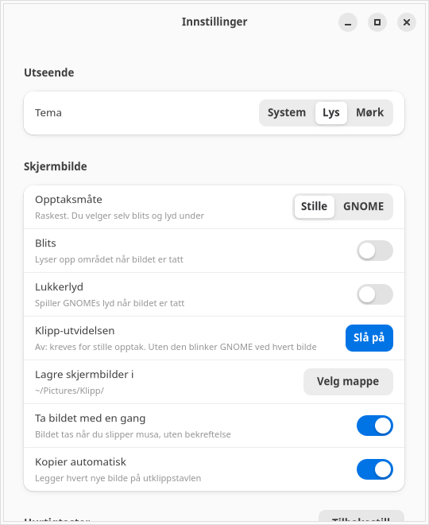

# Agentic Klipp

[](https://github.com/bejulian1/agentic-klipp/releases/tag/v1.2.1)
[Versjonslogg](CHANGELOG.md) · [Last ned](https://github.com/bejulian1/agentic-klipp/releases/latest) · [Bidragsytere](CONTRIBUTORS.md)

Skjermbildeverktøy for Ubuntu og GNOME, laget for å gi skjermbilder til AI-kodeagenter.
Trykk **Alt+K** i hvilken som helst app. Skjermen blir grå, du drar over det du vil ha,
og bildet er tatt når du slipper musa, uten blits og uten lukkerlyd. Du blir stående i
appen du jobbet i.

Bildet havner i hylla, på utklippstavlen og som fil under `~/Bilder/Klipp/`. Derfra kan
du dra det rett inn i terminalen, lime det inn i Claude Code eller tegne piler og
markeringer på det først.

- Område, frihånd, vindu eller hele skjermen
- Hylle med flervalg, bulk-kopi som filer og papirkurv
- Tegning med pil, linje, rektangel, ellipse, frihånd, merkepenn, tekst, nummererte
  markører, sladd og viskelær, i 8 farger pluss egen farge og 5 størrelser
- Egen GNOME Shell-utvidelse for stille opptak og Alt+K i alle apper

Skrevet i Rust med GTK 4 og libadwaita. Binæren heter `klipp`, og app-ID-en er
`io.github.AgenticKlipp`. Laget for Ubuntu 26.04 med GNOME 50 på Wayland.

## Skjermbilder

Hovedvinduet med bildehylla:


Innstillinger med tema og valg for skjermbilder:



Annoteringsmodus med tegneverktøy, farger og markeringer:


Bildene er fra appen med egne demobilder i en isolert profil.

## Installasjon

```sh
git clone https://github.com/bejulian1/agentic-klipp.git
cd agentic-klipp
./install.sh
```

`install.sh` sjekker at alt som trengs for å bygge er på plass. Mangler noe, skriver den
ut én `sudo apt install …`-kommando du kan kjøre før du prøver igjen. På en ny maskin
er det disse:

```sh
sudo apt install cargo rustc mold pkgconf libgtk-4-dev libadwaita-1-dev
```

Deretter bygger skriptet Klipp, legger den inn under `~/.local` og starter appen. Første
bygg tar noen minutter fordi release-profilen bruker LTO. Er maskinen trang på minne,
kjør `CARGO_BUILD_JOBS=2 ./install.sh`.

Til slutt, én gang: åpne **Innstillinger** i Klipp, trykk **Slå på** på raden
«Klipp-utvidelsen», og logg ut og inn. Da er blitsen borte og Alt+K virker overalt. Se
[Shell-utvidelsen](#shell-utvidelsen).

### Ferdig bygd versjon

[Nyeste release](https://github.com/bejulian1/agentic-klipp/releases/latest) inneholder:

- `klipp`: selve Linux-binæren.
- `agentic-klipp-1.2.1-linux-x86_64.tar.gz`: komplett installasjonsarkiv med binær, ikoner og GNOME-utvidelse.
- `agentic-klipp_1.2.1+20261114.1641_amd64.deb`: Ubuntu-pakke.
- `SHA256SUMS`: kontrollsummer for de tre filene.

Enklest uten å bygge: pakk ut installasjonsarkivet og kjør dette i den utpakkede mappen:

```sh
./install.sh --bin ./klipp
```

Alternativt kan Ubuntu-pakken installeres med:

```sh
sudo apt install ./agentic-klipp_1.2.1+20261114.1641_amd64.deb
```

Bruk én installasjonsmåte om gangen. Har du installert under `~/.local` tidligere og
vil bytte til `.deb`, kjør først `./uninstall.sh` for å fjerne brukerinstallasjonen.
Debian-pakken legger appen under `/usr/bin` og utvidelsen under `/usr/share`.
Slå på Klipp-utvidelsen i Innstillinger og logg ut og inn etter første installasjon.

Kontroller nedlastingene i mappen der filene og `SHA256SUMS` ligger:

```sh
sha256sum --check SHA256SUMS
```


Vil du slippe å bygge, last ned `klipp` fra
[Releases](https://github.com/bejulian1/agentic-klipp/releases) og pek på den. Da trengs
ingen Rust-pakker, bare GTK 4 og libadwaita, som GNOME allerede har:

```sh
./install.sh --bin ~/Nedlastinger/klipp
```

Binæren er bygd på Ubuntu 26.04 for x86_64.

### Oppdatering

```sh
git pull
./install.sh
```

Skriptet starter Klipp på nytt hvis den kjører. Har utvidelsen endret seg, må du logge ut
og inn før den nye versjonen tas i bruk.

### Hva som legges inn

Skriptet endrer ingen GNOME-innstillinger. Det legger inn dette:

- `~/.local/bin/klipp`
- `~/.local/share/applications/io.github.AgenticKlipp.desktop`
- `~/.local/share/icons/hicolor/scalable/apps/io.github.AgenticKlipp.svg`
- `~/.local/share/icons/hicolor/symbolic/apps/io.github.AgenticKlipp-symbolic.svg`
- `~/.local/share/gnome-shell/extensions/agentic-klipp@klipp.local/`

`.desktop`-filen er ikke pynt. Uten den nekter portalen å kjenne igjen Klipp, og både
global hurtigtast og skjermbilder uten dialog slutter å virke. Filen må hete
`io.github.AgenticKlipp.desktop` og ha absolutt sti i `Exec=`. `install.sh` ordner begge
deler.

Valg: `--bin STI` installerer en ferdig binær uten å bygge, og `--no-start` lar være å
starte appen. Bygget havner i `target/`, eller i `$CARGO_TARGET_DIR` hvis den er satt.

## Shell-utvidelsen

Slå på utvidelsen. Uten den får du hvit blits og lukkerlyd hver gang, for portalen ber
GNOME om det og har ikke noe valg for å la være. Utvidelsen tar også tasten selv, så
Alt+K virker i alle apper, og den starter Klipp hvis appen ikke kjører.

Åpne Innstillinger i Klipp og trykk **Slå på** på raden «Klipp-utvidelsen». Logg så ut
og inn én gang. GNOME på Wayland oppdager nye utvidelser bare ved innlogging, så blitsen
er der helt til det er gjort. Raden viser hele tiden hvor langt du har kommet. Oppdaterer
du Klipp til en ny versjon av utvidelsen, må du også logge ut og inn før den tas i bruk.

| | Med utvidelsen | Uten |
| --- | --- | --- |
| Blits og lukkerlyd | Nei | Ja, GNOME krever det |
| Fra tast til grå skjerm | Omtrent 0,2 s | Omtrent 0,8 s |
| Hurtigtast | Virker alltid | Bare mens Klipp kjører, etter en GNOME-dialog |
| Fokus i andre apper | Overlegget får alltid fokus | Kan mangle, og da virker verken Esc eller kopiering |

Utvidelsen er låst til GNOME 50 og må oppdateres ved ny GNOME-versjon. Klipp faller da
tilbake på portalen av seg selv. Bare Klipp får bruke den: den sjekker avsenderen slik
GNOME gjør for sin egen skjermbildetjeneste, og filen kan bare havne i
`$XDG_RUNTIME_DIR`.

## Første gang

Med utvidelsen på blir du ikke spurt om noe. Uten den stiller GNOME to spørsmål, og du
svarer på hvert av dem én gang:

1. **«Allow Agentic Klipp to Take Screenshots?»** dukker opp første gang du tar et
   bilde, og bare når Klipp er den fokuserte appen. Svar ja. Uten dette får ikke Klipp
   tatt bilder.
2. **«Legg til tastatursnarveier»** gjelder den globale hurtigtasten, se under.

## Bruk

```sh
klipp                    # vis vinduet
klipp --capture          # ta et bilde med sist brukte modus
klipp --capture --mode omrade|frihand|vindu|skjerm
klipp --hidden           # start skjult, for autostart
klipp --quit             # avslutt appen
```

## Autostart

Lag denne filen for å starte Klipp skjult ved innlogging:

```sh
mkdir -p ~/.config/autostart
cat > ~/.config/autostart/io.github.AgenticKlipp.desktop <<EOF
[Desktop Entry]
Type=Application
Name=Agentic Klipp
Exec="$HOME/.local/bin/klipp" --hidden
Icon=io.github.AgenticKlipp
X-GNOME-Autostart-enabled=true
EOF
```

Slett filen igjen for å slå av autostart.

## Hylla

| Handling | Hva som skjer |
| --- | --- |
| Klikk på bildet | Åpner det for tegning og markering |
| Shift+høyreklikk | Kopierer bildet |
| Shift+klikk | Kopierer filstien |
| Dra | Slipp bildet i terminalen eller en annen app |
| Søppelbøtta på bildet | Legger fila i papirkurven |
| Ctrl+klikk, Velg-knappen eller Ctrl+A | Velg flere bilder |
| Klikk eller Shift+klikk mens du velger | Velger ett bilde, eller alle imellom |
| Kopier (Ctrl+C) | Kopierer alle valgte som filer og stier. Ett bilde kopieres også som bilde |
| Søppelbøtta (Delete) mens du velger | Legger alle valgte i papirkurven |
| Dra et valgt bilde | Drar alle valgte |
| Esc eller ✕ | Avslutter valget |

Kopierte filer kan limes inn i Claude Code, chatapper og Filer. Minimer-knappen øverst
skjuler vinduet. Systemfeltet eller `klipp` henter det fram igjen.

## Tegning

Klikk på et bilde i hylla for å tegne på det. **Ferdig** brenner tegningen inn i fila,
og **Kopier** legger resultatet på utklippstavlen.

| Verktøy | Tast | Merknad |
| --- | --- | --- |
| Pil | P | |
| Linje | L | |
| Rektangel | R | |
| Ellipse | O | |
| Frihånd | F | |
| Merkepenn | H | Bred og gjennomsiktig, så teksten under kan leses |
| Tekst | T | Enter avslutter, Shift+Enter gir ny linje |
| Nummerert markør | M | Tallet øker for hver markør |
| Sladd | S | Gjør området uleselig |
| Viskelær | E | Fjerner hele tegninger. Det som blir fjernet, får stiplet rød ramme |

Tastene 1 til 8 velger farge: rød, oransje, gul, grønn, blå, lilla, hvit og svart. Tast 9
eller regnbueknappen gir egen farge fra GNOMEs fargevelger. Klikk på knappen igjen for å
bytte egen farge. Størrelsen velges i menyen til høyre, fra ekstra tynn til ekstra tykk,
eller med + og −. Ctrl+Z angrer, også viskelæret, og Ctrl+Shift+Z gjør om.

## Opptaksmåte

Velg under Innstillinger > Skjermbilde:

- **Stille** tar bildet gjennom utvidelsen. Det er raskest, og du velger selv om du vil
  ha **Blits** og **Lukkerlyd**. Begge er av som standard. De kommer når bildet er tatt,
  og blitsen dekker bare området du valgte. Uten utvidelsen brukes GNOMEs vei.
- **GNOME** bruker GNOMEs vanlige vei, med blits over hele skjermen og lukkerlyd før du
  markerer. De kan ikke slås av der, så bryterne er grå.

Alt+K virker med begge valgene.

## Lagringsmappe

Bilder lagres i `~/Bilder/Klipp/`. Velg en annen mappe under Innstillinger >
Skjermbilde. Knappen **Standard** tar deg tilbake. Bilder som allerede er tatt, blir
liggende der de er.

## Global hurtigtast

Standardtasten er Alt+K. Med utvidelsen på trenger du ikke gjøre noe mer, og tasten kan
byttes under Innstillinger > Hurtigtaster. Uten utvidelsen finnes det to andre veier.
**Velg én av dem.** Bruker du begge på samme tast, kan samme tastetrykk ta to bilder.

### GlobalShortcuts-portalen

Klipp ber GNOME om tasten når appen starter. Første gang åpner GNOME en dialog med
tittelen «Legg til tastatursnarveier» (eller «Add Keyboard Shortcuts»). Trykk
**Legg til**. Valget lagres av GNOME, så senere starter er stille.

- Tasten virker bare mens Klipp kjører. Bruk autostart hvis du vil ha den alltid.
- Bytter du tast under Innstillinger > Hurtigtaster, åpner GNOME en ny dialog som
  bekrefter den nye tasten.
- GNOME sier at tasten kan endres på appens side i Innstillinger. Raden «Ta skjermbilde»
  i Klipp viser hele tiden tasten GNOME faktisk bruker.
- Tasten virker på vanlig skrivebord, men ikke mens oversikten (Activities) er åpen.
- Lukker du dialogen uten å godta, spør ikke Klipp igjen ved neste start. Klikk raden
  «Ta skjermbilde» og trykk tasten på nytt for å bli spurt.

### GNOME-hurtigtast med `klipp --capture`

Bruk denne hvis portalen ikke virker, eller hvis du vil at tasten skal virke også når
Klipp ikke kjører.

1. Slå av portaltasten: åpne Innstillinger i Klipp, klikk raden «Ta skjermbilde» og trykk
   Backspace. Raden viser da «Ingen».
2. Åpne GNOME Innstillinger > Tastatur > View and Customize Shortcuts > Egendefinerte
   snarveier.
3. Legg til en snarvei med navnet `Klipp` og kommandoen under, med din egen sti:

   ```
   /home/DITT-NAVN/.local/bin/klipp --capture
   ```

4. Velg tasten.

Prøv kommandoen i en terminal først. Hvis du senere går tilbake til portalen eller
utvidelsen, må du fjerne den egendefinerte snarveien.

## Ikon i systemfeltet

GNOME viser ikke slike ikoner uten en utvidelse. Ubuntu har den med, men den kan være
slått av. Slå den på slik:

```sh
gnome-extensions enable ubuntu-appindicators@ubuntu.com
```

Klipp følger med, så ikonet dukker opp av seg selv uten at du må starte appen på nytt.
Uten utvidelsen virker alt annet som før, men da må du åpne Klipp fra appoversikten.

## Feilsøking

Se raden «Ta skjermbilde» under Innstillinger > Hurtigtaster. Den sier hva som er
galt.

| Tekst i raden | Hva det betyr | Løsning |
| --- | --- | --- |
| Aktiv: GNOME bruker … | Portalen har bundet tasten. | Ingenting. |
| GNOME bekrefter hurtigtasten selv. Svar i dialogen | Klipp venter på svar. | Svar i dialogen. Den kan ligge bak andre vinduer. |
| Klipp er ikke installert: … mangler | `.desktop`-filen finnes ikke. | Kjør `./install.sh`. |
| GNOME godtok ikke … | Dialogen ble lukket uten at tasten ble godtatt. | Klikk raden og trykk tasten på nytt. |
| ingen tast er valgt | Tasten er fjernet med Backspace. | Klikk raden og velg en tast. |
| GlobalShortcuts-portalen finnes ikke her | Skrivebordet mangler portalen. | Slå på utvidelsen. |

Andre ting å sjekke:

- **Hvit blits ved opptak:** Utvidelsen er ikke på. Sjekk med
  `gnome-extensions list --enabled | grep klipp`.
- **Status er Aktiv, men tasten reagerer ikke:** Uten utvidelsen kan dette skje hvis
  `xdg-desktop-portal` har krasjet. Logg ut og inn igjen.
- **Ingen ikon i systemfeltet:** Sjekk utvidelsen med
  `gnome-extensions list --enabled | grep appindicators`. Ikonet krever også
  `./install.sh`, ellers viser panelet tre prikker i stedet for Klipp-ikonet.
- **Innstillingene lastes ikke:** Filen `~/.config/klipp/config` er vanlig tekst. Er den
  ødelagt, bruker Klipp standardverdier for det den ikke forstår. Du kan trygt slette
  filen.

Vil du prøve delene alene under utvikling, finnes det eksempler. Bruk en midlertidig
`XDG_CONFIG_HOME`, så lar de innstillingene dine være i fred:

```sh
XDG_CONFIG_HOME=$(mktemp -d) cargo run -p klipp-system --example settings -- --hotkey
cargo run -p klipp-system --example tray
cargo run -p klipp-system --example hotkey
```

## Avinstallering

```sh
./uninstall.sh
```

Skriptet fjerner det `install.sh` la inn. Skjermbildene dine under `~/Bilder/Klipp/` og
innstillingene under `~/.config/klipp/` blir liggende. Du kan slette dem selv:

```sh
rm -r ~/.config/klipp
```

Har du laget autostart, skriver skriptet ut hvordan du fjerner den. Tasten GNOME har
lagret for Klipp, blir liggende i GNOMEs innstillinger og gjør ingen ting uten appen.

## Utvikling

```sh
cargo build --release
cargo test --workspace
cargo clippy --workspace --all-targets
```

| Mappe | Innhold |
| --- | --- |
| `src/` | Selve appen: vindu, hylle, opptak, utklippstavle og lagring |
| `crates/klipp-annotate/` | Tegnevinduet og verktøyene |
| `crates/klipp-system/` | Innstillinger, hurtigtaster, systemfelt og konfigurasjon |
| `shell-extension/` | GNOME Shell-utvidelsen for stille opptak og Alt+K |
| `data/` | Ikoner, CSS og GResource |
| `prototype/` | HTML-prototypen som er fasit for utseendet |

Versjon **1.2.1**, release-bygg **20261114.1641**. Versjonen står i alle tre
`Cargo.toml`-filene. Byggnummeret er byggetidspunktet i Europe/Oslo, og kan fastsettes
for en release med `KLIPP_BUILD_NUMBER=YYYYMMDD.HHMM`. Begge vises under
Innstillinger > Om Klipp og med `klipp --version`.

Klikk **Innstillinger > Om Klipp > Versjonslogg** for å åpne historikken i et eget vindu.
Loggen følger med appen og virker uten internett. Den hentes fra [CHANGELOG.md](CHANGELOG.md),
som også er versjonsloggen på GitHub. Nyeste versjon vises øverst, eldste nederst.
Versjon 1.0.0 er omtalt i kildekoden, men har ingen bevart publiseringsdato.

### Lage release-pakker

```sh
KLIPP_BUILD_NUMBER=20261114.1641 cargo build --release --locked
bash scripts/package-release.sh
```

Pakkene havner i `dist/`, som er ignorert av Git. Release-arkivet inneholder bare
appen, installasjonsfiler og dokumentasjon. Tester og byggemapper pakkes ikke med.
Linux-pakkene publiseres i **GitHub Releases**. GitHub Packages har ikke et eget
Debian/apt-register; `.deb`-filen lastes derfor ned fra Releases. Se
[GitHubs støttede pakkeformater](https://docs.github.com/en/packages/learn-github-packages/introduction-to-github-packages#supported-clients-and-formats).

## Bidragsytere

**Julian / [bejulian1](https://github.com/bejulian1)** eier prosjektet og står for
produktvalg og utprøving. **Claude Opus 5.5 / Claude Code** laget den opprinnelige
implementasjonen. **Codex / OpenAI**, med **GPT-6.1 Sol**, bidro med versjonslogg,
versjon 1.2.1, dokumentasjon og release-pakking.

Se [CONTRIBUTORS.md](CONTRIBUTORS.md) for kreditering. GitHubs automatiske Contributors-liste
styres av commitforfattere og koblede GitHub-kontoer.

## Lisens

[MIT](LICENSE).
