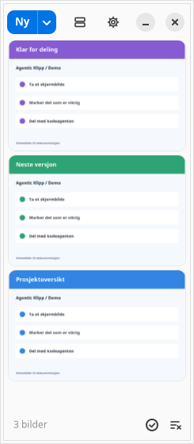
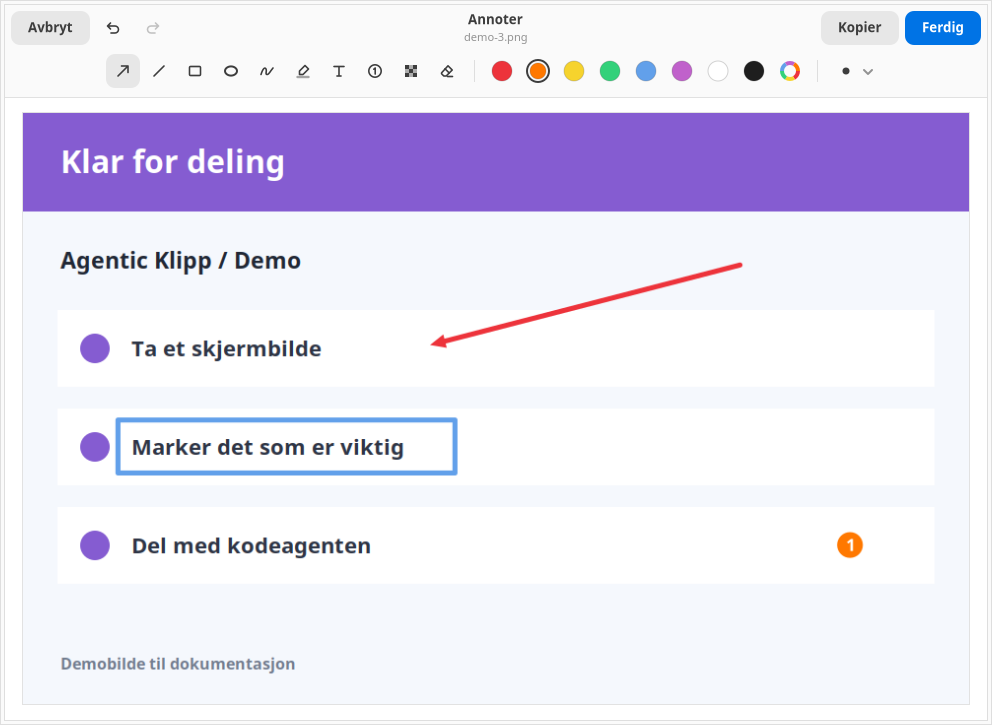

# Agentic Klipp

[](https://github.com/bejulian1/agentic-klipp/releases/tag/v1.2.1)
[Version history](#version-history) · [Download](https://github.com/bejulian1/agentic-klipp/releases/latest) · [Contributors](#contributors)

A screenshot tool for Ubuntu and GNOME, built for handing screenshots to AI coding agents.
Press **Alt+K** in any app. The screen dims, you drag over what you want, and the screenshot
is captured as soon as you release the mouse — with no flash and no shutter sound. You stay
right in the app you were working in.

> **Note:** The app's UI is currently in Norwegian (bokmål) only. Translations and i18n
> contributions are welcome — see [Contributing](#contributing).

The image lands on the shelf, on your clipboard, and as a file in `Klipp/` inside your
Pictures folder (`~/Pictures/Klipp/`, or `~/Bilder/Klipp/` on a Norwegian system). From
there you can drag it straight into your terminal, paste it into Claude Code, or draw
arrows and callouts on it first.

- Area, freehand, window, or full-screen capture
- Shelf with multi-select, bulk copy as files, and trash
- Annotation with arrow, line, rectangle, ellipse, freehand, highlighter, text, numbered
  markers, redaction, and eraser, in 8 colors plus a custom color and 5 sizes
- Dedicated GNOME Shell extension for silent capture and global Alt+K in all apps

Written in Rust with GTK 4 and libadwaita. The binary is named `klipp`, and the app ID is
`io.github.AgenticKlipp`. Built for Ubuntu 26.04 with GNOME 50 on Wayland.

## Screenshots

Main window with the screenshot shelf:



Settings with theme and screenshot options:


Annotation mode with drawing tools, colors, and callouts:



The screenshots are taken from the app with demo images in an isolated profile.

## Version history

<details>
<summary>Show all versions (in Norwegian, same text as in the app) – newest first</summary>

<!-- BEGIN VERSION HISTORY -->

### 1.2.1 — 2026-11-14

- Teksten i versjonsloggen kan ikke markeres eller få tekstfokus.
- Fjernet den blå tekstmarkeringen som kom automatisk øverst ved åpning.
- Fjernet innledningsteksten over versjonene.
- Nyeste versjon vises øverst, eldste nederst.
- README viser hovedvinduet, toppen av Innstillinger og annoteringsmodus.

### 1.2.0 — 2026-11-14

- Ny klikkbar Versjonslogg under Innstillinger → Om Klipp.
- Eget rullbart vindu med versjonene fra eldste til nyeste og gjeldende versjon og byggnummer.
- Samme innebygde versjonslogg i appen og på GitHub, også tilgjengelig uten internett.
- Felles versjon 1.2.0 for appen og de interne bibliotekene.
- Byggnummer kan fastsettes ved release; lokale bygg bruker tidspunktet i Europe/Oslo.
- Oppdatert README med tre skjermbilder og kreditering av Claude og Codex.
- Release-pakker med Linux-binær, installasjonsarkiv, Debian-pakke og SHA-256-kontrollsummer.

### 1.1.1 — 2026-11-08

Første taggede og publiserte GitHub-versjon. Oppsummerer også utviklingen i 1.1-serien før publisering.

- Skjermbilder av område, frihånd, vindu og hele skjermen, med Alt+K som standard.
- GNOME Shell-utvidelse for stille opptak og global hurtigtast.
- Hylle med flervalg, samlet kopiering og papirkurv.
- Tegneverktøy med blant annet pil, linje, ellipse, merkepenn, tekst, sladd og viskelær.
- Åtte farger, egen farge og fem størrelser i tegnevinduet.
- Minimer-knapp og signaturen Code Pro under Om Klipp.
- Installasjonsskript som sjekker avhengigheter, bygger, installerer og starter appen.

### 1.0.0 — Tidlig lokal versjon

Første lokale versjon, omtalt i konfigurasjonsmigreringen. Nøyaktig dato og full endringsliste er ikke bevart i Git-historikken.

- Den globale hurtigtasten var Super+Shift+K.
- Hylla var bred som standard, og opptak hadde et eget bekreftelsessteg.

<!-- END VERSION HISTORY -->

</details>

[Open version history as a separate file](CHANGELOG.md) · [All releases and downloads](https://github.com/bejulian1/agentic-klipp/releases)

## Installation

```sh
git clone https://github.com/bejulian1/agentic-klipp.git
cd agentic-klipp
./install.sh
```

`install.sh` checks that everything needed to build is installed. If anything is missing, it
prints a single `sudo apt install …` command you can run before trying again. On a fresh
machine, those packages are:

```sh
sudo apt install cargo rustc mold pkgconf libgtk-4-dev libadwaita-1-dev
```

The script then builds Klipp, installs it under `~/.local`, and launches the app. The first
build takes a few minutes because the release profile uses LTO. If your machine is low on
memory, run `CARGO_BUILD_JOBS=2 ./install.sh`.

Finally, once: open **Innstillinger** (Settings) in Klipp, click **Slå på** (Enable) on the
"Klipp-utvidelsen" (Klipp extension) row, and log out and back in. After that, the flash is
gone and Alt+K works everywhere. See [Shell extension](#shell-extension).

### Prebuilt release

The [latest release](https://github.com/bejulian1/agentic-klipp/releases/latest) includes:

- `klipp`: the standalone Linux binary.
- `agentic-klipp-1.2.1-linux-x86_64.tar.gz`: complete installation archive with binary, icons, and GNOME extension.
- `agentic-klipp_1.2.1+20261114.1641_amd64.deb`: Ubuntu package.
- `SHA256SUMS`: checksums for the three files.

Easiest way without building: extract the installation archive and run this inside the
extracted folder:

```sh
./install.sh --bin ./klipp
```

Alternatively, install the Ubuntu package with:

```sh
sudo apt install ./agentic-klipp_1.2.1+20261114.1641_amd64.deb
```

Use one installation method at a time. If you previously installed under `~/.local` and
want to switch to the `.deb`, run `./uninstall.sh` first to remove the user installation.
The Debian package installs the app under `/usr/bin` and the extension under `/usr/share`.
Enable the Klipp extension in **Innstillinger** and log out and back in after the first
installation.

Verify the downloads in the folder containing the files and `SHA256SUMS`:

```sh
sha256sum --check SHA256SUMS
```

If you want to skip building from a cloned repo, download `klipp` from
[Releases](https://github.com/bejulian1/agentic-klipp/releases) and point to it. No Rust
packages are needed — only GTK 4 and libadwaita, which GNOME already includes:

```sh
./install.sh --bin ~/Downloads/klipp
```

The binary is built on Ubuntu 26.04 for x86_64.

### Updating

```sh
git pull
./install.sh
```

The script restarts Klipp if it is currently running. If the extension has changed, you
need to log out and back in before the new version takes effect.

### What gets installed

The script does not modify any GNOME settings. It installs:

- `~/.local/bin/klipp`
- `~/.local/share/applications/io.github.AgenticKlipp.desktop`
- `~/.local/share/icons/hicolor/scalable/apps/io.github.AgenticKlipp.svg`
- `~/.local/share/icons/hicolor/symbolic/apps/io.github.AgenticKlipp-symbolic.svg`
- `~/.local/share/gnome-shell/extensions/agentic-klipp@klipp.local/`

The `.desktop` file is not decorative. Without it, the desktop portal refuses to recognize
Klipp, and both the global shortcut and dialog-free screenshots stop working. The file must
be named `io.github.AgenticKlipp.desktop` and have an absolute path in `Exec=`. `install.sh`
handles both.

Options: `--bin PATH` installs a prebuilt binary without compiling, and `--no-start` skips
launching the app. Build artifacts go to `target/`, or `$CARGO_TARGET_DIR` if set.

## Shell extension

Enable the extension. Without it, you get a white flash and shutter sound every time,
because the portal asks GNOME for them and has no option to turn them off. The extension
also grabs the hotkey itself, so Alt+K works in all apps and starts Klipp if it isn't
running.

Open **Innstillinger** in Klipp and click **Slå på** on the "Klipp-utvidelsen" row. Then
log out and back in once. GNOME on Wayland only discovers new extensions at login, so the
flash remains until you do. The row always shows your current setup status. Whenever you
update Klipp to a new version of the extension, you also need to log out and back in before
it takes effect.

| | With extension | Without |
| --- | --- | --- |
| Flash and shutter sound | No | Yes, GNOME requires it |
| Keypress to dimmed screen | About 0.2 s | About 0.8 s |
| Hotkey | Always works | Only while Klipp is running, after a GNOME dialog |
| Focus in other apps | Overlay always gets focus | May lack focus, breaking Esc and copy |

The extension is pinned to GNOME 50 and must be updated for newer GNOME versions. Klipp
falls back to the portal automatically if it is unavailable. Only Klipp is allowed to call
it: it verifies the D-Bus sender the same way GNOME does for its own screenshot service,
and files can only be written inside `$XDG_RUNTIME_DIR`.

## First run

With the extension enabled, you will not be prompted for anything. Without it, GNOME asks
two questions, once each:

1. **"Allow Agentic Klipp to Take Screenshots?"** appears the first time you take a
   screenshot, and only when Klipp is the focused app. Click Allow. Without this, Klipp
   cannot capture screenshots.
2. **"Legg til tastatursnarveier"** (Add Keyboard Shortcuts) is for the global shortcut —
   see below.

## Usage

```sh
klipp                    # show the window
klipp --capture          # capture using the last used mode
klipp --capture --mode omrade|frihand|vindu|skjerm
klipp --hidden           # start hidden, for autostart
klipp --quit             # quit the app
```

The `--mode` values are `omrade` (area), `frihand` (freehand), `vindu` (window), and
`skjerm` (full screen).

## Autostart

Create this file to start Klipp hidden on login:

```sh
mkdir -p ~/.config/autostart
cat > ~/.config/autostart/io.github.AgenticKlipp.desktop <<EOF
[Desktop Entry]
Type=Application
Name=Agentic Klipp
Exec="$HOME/.local/bin/klipp" --hidden
Icon=io.github.AgenticKlipp
X-GNOME-Autostart-enabled=true
EOF
```

Delete the file to disable autostart.

## The shelf

| Action | Result |
| --- | --- |
| Click an image | Opens it for drawing and annotation |
| Shift+right-click | Copies the image |
| Shift+click | Copies the file path |
| Drag | Drops the image into a terminal or another app |
| Trash icon on the image | Moves the file to Trash |
| Ctrl+click, the **Velg** (Select) button, or Ctrl+A | Select multiple images |
| Click or Shift+click while selecting | Selects one image, or a range |
| **Kopier** (Copy, Ctrl+C) | Copies all selected items as files and paths. A single image is also copied as image data |
| Trash icon (Delete) while selecting | Moves all selected items to Trash |
| Drag a selected image | Drags all selected images |
| Esc or ✕ | Exits selection mode |

Copied files can be pasted into Claude Code, chat apps, and Files. The minimize button at
the top hides the window; the system tray icon or running `klipp` brings it back.

## Annotation

Click an image on the shelf to draw on it. **Ferdig** (Done) bakes the annotations into the
file, and **Kopier** puts the result on the clipboard.

| Tool | Key | Notes |
| --- | --- | --- |
| Arrow | P | |
| Line | L | |
| Rectangle | R | |
| Ellipse | O | |
| Freehand | F | |
| Highlighter | H | Wide and semi-transparent so underlying text stays readable |
| Text | T | Enter finishes, Shift+Enter inserts a newline |
| Numbered marker | M | Counter increments for each marker |
| Redact | S | Obscures the selected area |
| Eraser | E | Removes whole strokes/shapes; items to be removed get a dashed red outline |

Keys 1 through 8 pick a color: red, orange, yellow, green, blue, purple, white, and black.
Key 9 or the rainbow button picks a custom color from GNOME's color chooser; click the button
again to change the custom color. Stroke size is chosen from the menu on the right (from
extra thin to extra thick), or with `+` and `−`. Ctrl+Z undoes (including eraser actions),
and Ctrl+Shift+Z redoes.

## Capture method

Choose under **Innstillinger > Skjermbilde** (Settings > Screenshot):

- **Stille** (Silent) captures through the extension. It is the fastest option, and you can
  choose whether to enable **Blits** (Flash) and **Lukkerlyd** (Shutter sound). Both are
  off by default. They trigger after the screenshot is taken, and the flash only covers the
  selected region. Without the extension, Klipp falls back to GNOME's method.
- **GNOME** uses GNOME's standard screenshot flow, with a full-screen flash and shutter
  sound before you select an area. These cannot be disabled there, so the toggles are
  grayed out.

Alt+K works with both options.

## Save folder

Screenshots are saved in `Klipp/` inside your Pictures folder (`~/Pictures/Klipp/`, or
`~/Bilder/Klipp/` on a Norwegian system). Choose a different folder under **Innstillinger >
Skjermbilde**. The **Standard** (Default) button resets it. Screenshots already taken stay
where they are.

## Global shortcut

The default shortcut is Alt+K. With the extension enabled, no further setup is needed, and
you can change the key under **Innstillinger > Hurtigtaster** (Settings > Shortcuts).
Without the extension, there are two alternatives. **Pick only one.** Binding the same key
with both can trigger two screenshots at once.

### GlobalShortcuts portal

Klipp requests the shortcut from GNOME when the app starts. The first time, GNOME opens a
dialog titled "Legg til tastatursnarveier" (or "Add Keyboard Shortcuts"). Click **Legg til**
(Add). GNOME remembers your choice, so subsequent launches are silent.

- The shortcut only works while Klipp is running. Use autostart if you want it available at
  all times.
- If you change the key under **Innstillinger > Hurtigtaster**, GNOME opens a new dialog to
  confirm the new key.
- GNOME notes that the shortcut can be changed on the app's page in GNOME Settings. The
  "Ta skjermbilde" (Take screenshot) row in Klipp always shows the key GNOME is actually
  using.
- The shortcut works on the regular desktop, but not while the Activities overview is open.
- If you dismiss the dialog without accepting, Klipp will not prompt again on the next
  start. Click the "Ta skjermbilde" row and press the key again to be prompted.

### GNOME custom shortcut with `klipp --capture`

Use this if the portal does not work, or if you want the shortcut to work even when Klipp
is not running.

1. Clear the portal shortcut: open **Innstillinger** in Klipp, click the "Ta skjermbilde"
   row, and press Backspace. The row will then show "Ingen" (None).
2. Open GNOME Settings > Keyboard > View and Customize Shortcuts > Custom Shortcuts.
3. Add a shortcut named `Klipp` with the command below, using your own path:

   ```
   /home/YOUR-NAME/.local/bin/klipp --capture
   ```

4. Choose the shortcut key.

Test the command in a terminal first. If you later switch back to the portal or the
extension, remember to remove the custom shortcut.

## System tray icon

GNOME does not show tray icons without an extension. Ubuntu ships it preinstalled, though
it may be disabled. Enable it with:

```sh
gnome-extensions enable ubuntu-appindicators@ubuntu.com
```

Klipp watches for it, so the icon appears automatically without restarting the app. Without
the extension everything else works as usual, except you open Klipp from the app overview.

## Troubleshooting

Check the "Ta skjermbilde" row under **Innstillinger > Hurtigtaster**. It reports what is
wrong.

| Status text in the app | Meaning | Fix |
| --- | --- | --- |
| `Aktiv: GNOME bruker …` | The portal has bound the key. | Nothing needed. |
| `GNOME bekrefter hurtigtasten selv. Svar i dialogen` | Klipp is waiting for confirmation. | Respond to the dialog (it may be behind other windows). |
| `Klipp er ikke installert: … mangler` | The `.desktop` file is missing. | Run `./install.sh`. |
| `GNOME godtok ikke …` | The dialog was dismissed without accepting the key. | Click the row and press the key again. |
| `ingen tast er valgt` | The key was cleared with Backspace. | Click the row and pick a key. |
| `GlobalShortcuts-portalen finnes ikke her` | The desktop lacks the GlobalShortcuts portal. | Enable the shell extension. |

Other things to check:

- **White flash on capture:** The extension is not enabled. Check with
  `gnome-extensions list --enabled | grep klipp`.
- **Status says Active, but the key does nothing:** Without the extension, this can happen
  if `xdg-desktop-portal` has crashed. Log out and back in.
- **No system tray icon:** Check the extension with
  `gnome-extensions list --enabled | grep appindicators`. The icon also requires
  `./install.sh`, otherwise the top bar shows three dots instead of the Klipp icon.
- **Settings are not loading:** `~/.config/klipp/config` is plain text. If it is corrupted,
  Klipp falls back to defaults for any entries it cannot parse. You can safely delete the
  file.

If you want to test components in isolation during development, there are examples. Pass a
temporary `XDG_CONFIG_HOME` so they leave your real settings alone:

```sh
XDG_CONFIG_HOME=$(mktemp -d) cargo run -p klipp-system --example settings -- --hotkey
cargo run -p klipp-system --example tray
cargo run -p klipp-system --example hotkey
```

## Uninstalling

```sh
./uninstall.sh
```

The script removes everything `install.sh` installed. Your screenshots in `Klipp/` inside
your Pictures folder and your settings in `~/.config/klipp/` are left untouched. You can
delete the settings yourself:

```sh
rm -r ~/.config/klipp
```

If you set up autostart, the script prints how to remove it. Any shortcut GNOME stored for
Klipp stays in GNOME Settings and has no effect once the app is removed.

## Development

```sh
cargo build --release
cargo test --workspace
cargo clippy --workspace --all-targets
```

| Directory | Contents |
| --- | --- |
| `src/` | The app itself: window, shelf, capture, clipboard, and storage |
| `crates/klipp-annotate/` | Annotation window and drawing tools |
| `crates/klipp-system/` | Settings, hotkeys, system tray, and configuration |
| `shell-extension/` | GNOME Shell extension for silent capture and Alt+K |
| `data/` | Icons, CSS, and GResource |
| `prototype/` | HTML prototype used as the visual reference |

Version **1.2.1**, release build **20261114.1641**. The version is declared in all three
`Cargo.toml` files. The build number is the build timestamp in `Europe/Oslo`, and can be
pinned for a release with `KLIPP_BUILD_NUMBER=YYYYMMDD.HHMM`. Both are shown under
**Innstillinger > Om Klipp** (Settings > About Klipp) and via `klipp --version`.

Click **Innstillinger > Om Klipp > Versjonslogg** (Version history) to open the changelog
in its own window. The changelog is bundled with the app and works offline. It is sourced
from [CHANGELOG.md](CHANGELOG.md), which is also the changelog on GitHub. The newest
version is shown at the top and the oldest at the bottom. Version 1.0.0 is referenced in
the source code, but its original release date was not preserved.

### Building release packages

```sh
python3 scripts/update-readme-history.py
KLIPP_BUILD_NUMBER=20261114.1641 cargo build --release --locked
bash scripts/package-release.sh
```

Packages are written to `dist/`, which is ignored by Git. The release archive contains only
the app, installation files, and documentation — tests and build directories are excluded.
Linux packages are published on **GitHub Releases**. GitHub Packages does not offer a
Debian/apt registry, so the `.deb` file is downloaded from Releases. See
[GitHub's supported package formats](https://docs.github.com/en/packages/learn-github-packages/introduction-to-github-packages#supported-clients-and-formats).

## Contributing

Contributions — bug reports, features, translations, and documentation — are welcome!

- Read [CONTRIBUTING.md](CONTRIBUTING.md) for dev setup, coding guidelines, and PR expectations.
- Follow our [Code of Conduct](CODE_OF_CONDUCT.md).
- To report a security issue privately, see [SECURITY.md](SECURITY.md).

## Contributors

| Contributor / model | Tool | Contribution |
| --- | --- | --- |
| **Julian / [bejulian1](https://github.com/bejulian1)** | | Project owner, product decisions, and testing |
| **Anthropic Claude Opus 5.5** | Claude Code | Initial implementation and development through 1.1.1 |
| **OpenAI GPT 6.1 Sol** | Codex | Version history, 1.2 series, documentation, and release packaging |

See [CONTRIBUTORS.md](CONTRIBUTORS.md) for full attribution. GitHub's automatic Contributors
list is based on commit authors and linked GitHub accounts; see
[GitHub's documentation](https://docs.github.com/en/repositories/viewing-activity-and-data-for-your-repository/viewing-a-projects-contributors).

## License

[MIT](LICENSE).
