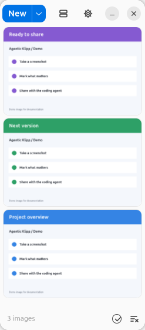
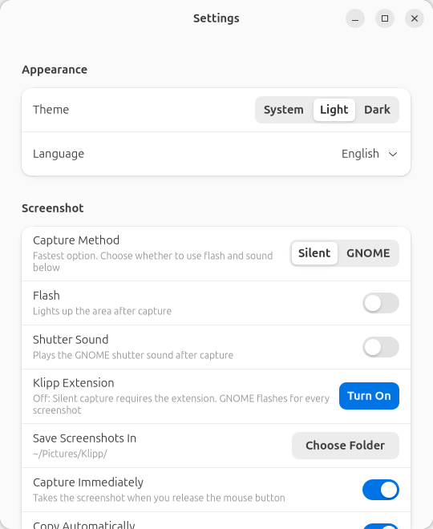
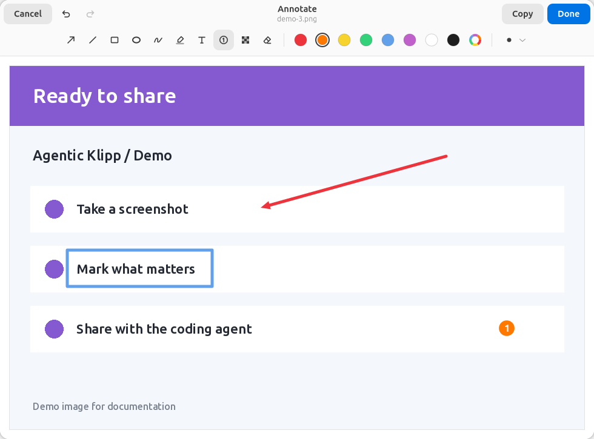

# Agentic Screenshot

[](CHANGELOG.md)
[Version history](#version-history) · [Download](https://github.com/bejulian1/agentic-screenshot/releases/latest) · [Contributors](#contributors)

> **Formerly Agentic Klipp.** Version 2.0.0 renamed the app to Agentic Screenshot. Upgrading
> keeps your settings, shelf, and screenshots: see [Upgrading from Agentic Klipp](#upgrading-from-agentic-klipp).

A screenshot tool for Ubuntu and GNOME, built for handing screenshots to AI coding agents.
Press **Alt+K** in any app. The screen dims, you drag over what you want, and the screenshot
is captured as soon as you release the mouse — with no flash and no shutter sound. You stay
right in the app you were working in.

> **Languages:** English, Norsk bokmål, Svenska, Dansk, Deutsch, Français, Español, Italiano,
> Português (Brasil) and Nederlands. The app follows your system language by default (English
> when it isn't supported). Choose another under **Settings → Appearance → Language** and
> click **Restart**. The labels below are the English ones.

The image lands on the shelf, on your clipboard, and as a file in `Agentic Screenshot/`
inside your Pictures folder (`~/Pictures/Agentic Screenshot/`, or
`~/Bilder/Agentic Screenshot/` on a Norwegian system). From
there you can drag it straight into your terminal, paste it into Claude Code, or draw
arrows and callouts on it first.

- Area, freehand, window, or full-screen capture
- Shelf with multi-select, bulk copy as files, and trash
- Annotation with arrow, line, rectangle, ellipse, freehand, highlighter, text, numbered
  markers, redaction, and eraser, in 8 colors plus a custom color and 5 sizes
- Dedicated GNOME Shell extension for silent capture and global Alt+K in all apps

Written in Rust with GTK 4 and libadwaita. The binary is named `agentic-screenshot`, and the app ID is
`io.github.AgenticScreenshot`. Built for Ubuntu 26.04 with GNOME 50 on Wayland.

## Screenshots

Main window with the screenshot shelf:



Settings with theme, language, and screenshot options:



Annotation mode with drawing tools, colors, and callouts:



The screenshots are taken from the app with demo images in an isolated profile.

## Version history

<details>
<summary>Show all versions (same text as in the app) – newest first</summary>

<!-- BEGIN VERSION HISTORY -->

### 2.0.2 — 2026-11-23

- Flash and Shutter Sound in Settings can be changed again before the extension is running. They were grayed out in 2.0.1. The text under Capture Method still explains that GNOME takes the screenshot with flash and sound until you log out and back in.

### 2.0.1 — 2026-11-23

- The window opens in the middle of the screen again when you reopen it. After the minimize button had been used once, reopening from the app overview put the window in the top-left corner, and reopening from the system tray did not show it at all.
- Settings and the drawing window no longer come back minimized after a screenshot just because they had been minimized once before.
- When the Agentic Screenshot extension is turned on but GNOME has not loaded it yet, the app tells you once that GNOME took the screenshot with flash and sound, and that silent capture works after you log out and back in. Settings says the same under Capture Method, and Flash and Shutter Sound are grayed out until the extension is running.
- The shortcut no longer takes the first screenshot with flash and sound when it has to start the app first.
- Ctrl+A, Delete, and the other shortcuts in the main window do nothing while Settings or the drawing window is open.
- The trash button on an image is hidden from screen readers too while you select several images.
- A freehand capture that is only a line is rejected as too small, instead of saving an empty image.
- The drawing window fits on small screens and in half a screen. The toolbar scrolls sideways when there is not room for all of it.
- Saving in the drawing window keeps the extended permissions (ACL) of the file.

### 2.0.0 — 2026-11-23

- Agentic Klipp is now called Agentic Screenshot. The binary is `agentic-screenshot`, the app ID is `io.github.AgenticScreenshot`, and the Shell extension is `agentic-screenshot@bejulian1.github.io`.
- The first time the new version starts, settings, the shelf, and the cache move automatically from `~/.config/klipp`, `~/.local/state/klipp`, and `~/.cache/klipp` to folders named `agentic-screenshot`. Autostart and custom GNOME shortcuts that launched `klipp` are pointed at the new binary, and the new extension is turned on if the old one was on.
- Screenshots are never moved. If you used the default `Pictures/Klipp` folder, new screenshots keep going there after the upgrade. New installations save to `Pictures/Agentic Screenshot`, with file names that start with `screenshot-`.
- install.sh removes the old binary, .desktop file, icons, autostart entry, and extension before installing the new ones.
- Log out and back in once after upgrading so GNOME Shell loads the renamed extension. Until then, GNOME captures with a flash.
- Without the extension, GNOME asks once more for screenshot access and for the keyboard shortcut, because the app has a new app ID.
- The Debian package is named `agentic-screenshot` and replaces `agentic-klipp`.
- The version history in the app is shown in English for every language except Norwegian Bokmål, which still gets the Norwegian one.
- Restart in Settings no longer leaves the app closed when the old process is slow to be cleaned up. The new instance starts anyway after five seconds.

### 1.3.0 — 2026-11-20

- Klipp is now available in ten languages: Norwegian Bokmål, English, Swedish, Danish, German, French, Spanish, Italian, Brazilian Portuguese, and Dutch.
- New language option under Settings → Appearance. The default is the system language, and Klipp uses English when the system language is not supported.
- The Restart button applies the new language right away.
- The app name and the quick actions in the app overview are translated.
- The option buttons in Settings always show the full text.
- The screenshot shelf no longer loses history during rapid changes, right after startup, or when the pictures folder is disconnected. A corrupted shelf file is kept as shelf.tsv.ugyldig.
- Freehand captures are fully transparent outside the shape, and Copy in the drawing window also works after you have switched apps.
- The Debian package finds the Klipp extension, and Alt+K works after installing from the package.
- The source code is open on GitHub with an English README, contribution guidelines, and automated testing.
- The README shows new screenshots in English.

### 1.2.1 — 2026-11-14

- The text in the version history cannot be selected or receive text focus.
- Removed the blue text selection that appeared automatically at the top when opening.
- Removed the introduction text above the versions.
- The newest version is shown at the top, the oldest at the bottom.
- The README shows the main window, the top of Settings, and annotation mode.

### 1.2.0 — 2026-11-14

- New clickable Version History under Settings → About Klipp.
- Separate scrollable window with the versions from oldest to newest, and the current version and build number.
- The same built-in version history in the app and on GitHub, also available offline.
- Shared version 1.2.0 for the app and the internal libraries.
- The build number can be pinned at release; local builds use the time in Europe/Oslo.
- Updated README with three screenshots and credits for Claude and Codex.
- Release packages with a Linux binary, installation archive, Debian package, and SHA-256 checksums.

### 1.1.1 — 2026-11-08

First tagged and published GitHub version. Also summarizes the development in the 1.1 series before publication.

- Screenshots of an area, freehand, a window, and the entire screen, with Alt+K as the default.
- GNOME Shell extension for silent capture and a global shortcut.
- Shelf with multi-select, bulk copy, and trash.
- Drawing tools including arrow, line, ellipse, highlighter, text, redaction, and eraser.
- Eight colors, a custom color, and five sizes in the drawing window.
- Minimize button and the Code Pro signature under About Klipp.
- Installation script that checks dependencies, builds, installs, and launches the app.

### 1.0.0 — Early local version

First local version, referenced in the configuration migration. The exact date and full list of changes were not preserved in the Git history.

- The global shortcut was Super+Shift+K.
- The shelf was wide by default, and capturing had a separate confirmation step.

<!-- END VERSION HISTORY -->

</details>

[Open version history as a separate file](CHANGELOG.md) · [Norwegian version history](CHANGELOG.nb.md) · [All releases and downloads](https://github.com/bejulian1/agentic-screenshot/releases)

## Installation

```sh
git clone https://github.com/bejulian1/agentic-screenshot.git
cd agentic-screenshot
./install.sh
```

`install.sh` checks that everything needed to build is installed. If anything is missing, it
prints a single `sudo apt install …` command you can run before trying again. On a fresh
machine, those packages are:

```sh
sudo apt install cargo rustc mold pkgconf libgtk-4-dev libadwaita-1-dev
```

The script then builds Agentic Screenshot, installs it under `~/.local`, and launches the app. The first
build takes a few minutes because the release profile uses LTO. If your machine is low on
memory, run `CARGO_BUILD_JOBS=2 ./install.sh`.

Finally, once: open **Settings** in Agentic Screenshot, click **Turn On** on the
**Agentic Screenshot Extension** row, and log out and back in. After that, the flash is
gone and Alt+K works everywhere. See [Shell extension](#shell-extension).

### Prebuilt release

The [latest release](https://github.com/bejulian1/agentic-screenshot/releases/latest) includes:

- `agentic-screenshot`: the standalone Linux binary.
- `agentic-screenshot-<version>-linux-x86_64.tar.gz`: complete installation archive with binary, icons, and GNOME extension.
- `agentic-screenshot_<version>+<build>_amd64.deb`: Ubuntu package.
- `SHA256SUMS`: checksums for the three files.

Easiest way without building: extract the installation archive and run this inside the
extracted folder:

```sh
./install.sh --bin ./agentic-screenshot
```

Alternatively, install the Ubuntu package with:

```sh
sudo apt install ./agentic-screenshot_<version>+<build>_amd64.deb
```

Use one installation method at a time. If you previously installed under `~/.local` and
want to switch to the `.deb`, run `./uninstall.sh` first to remove the user installation.
The Debian package installs the app under `/usr/bin` and the extension under `/usr/share`.
Enable the Agentic Screenshot extension in **Settings** and log out and back in after the
first installation.

Verify the downloads in the folder containing the files and `SHA256SUMS`:

```sh
sha256sum --check SHA256SUMS
```

If you want to skip building from a cloned repo, download `agentic-screenshot` from
[Releases](https://github.com/bejulian1/agentic-screenshot/releases) and point to it. No Rust
packages are needed — only GTK 4 and libadwaita, which GNOME already includes:

```sh
./install.sh --bin ~/Downloads/agentic-screenshot
```

The binary is built on Ubuntu 26.04 for x86_64.

### Updating

```sh
git pull
./install.sh
```

The script restarts Agentic Screenshot if it is currently running. If the extension has
changed, you need to log out and back in before the new version takes effect.

### Upgrading from Agentic Klipp

Version 2.0.0 renamed Agentic Klipp to Agentic Screenshot. Install it the same way as
before (`git pull` and `./install.sh`, the new installation archive, or the new `.deb`).
Nothing you had is lost:

- `install.sh` stops the old app and removes `~/.local/bin/klipp`, the old `.desktop` file,
  the old icons, and the old extension `agentic-klipp@klipp.local`. If the old extension was
  turned on, the new one is turned on instead. An autostart entry is moved to the new name.
  The `.deb` package replaces the `agentic-klipp` package.
- The first time Agentic Screenshot starts, it moves `~/.config/klipp`,
  `~/.local/state/klipp`, and `~/.cache/klipp` to folders named `agentic-screenshot`. Custom
  GNOME shortcuts that ran `klipp` are pointed at the new binary.
- Your screenshots stay where they are. If you used the default `Klipp/` folder in Pictures,
  new screenshots keep going there. Choose another folder under **Settings > Screenshot**
  whenever you like.
- **Log out and back in once.** GNOME on Wayland only loads the renamed extension at login,
  so screenshots are taken with a flash until you do.
- Without the extension, GNOME asks once more for screenshot access and for the keyboard
  shortcut, because the app has a new app ID.

### What gets installed

A fresh installation does not modify any GNOME settings. It installs:

- `~/.local/bin/agentic-screenshot`
- `~/.local/share/applications/io.github.AgenticScreenshot.desktop`
- `~/.local/share/icons/hicolor/scalable/apps/io.github.AgenticScreenshot.svg`
- `~/.local/share/icons/hicolor/symbolic/apps/io.github.AgenticScreenshot-symbolic.svg`
- `~/.local/share/gnome-shell/extensions/agentic-screenshot@bejulian1.github.io/`

The `.desktop` file is not decorative. Without it, the desktop portal refuses to recognize
the app, and both the global shortcut and dialog-free screenshots stop working. The file must
be named `io.github.AgenticScreenshot.desktop` and have an absolute path in `Exec=`. `install.sh`
handles both.

Options: `--bin PATH` installs a prebuilt binary without compiling, and `--no-start` skips
launching the app. Build artifacts go to `target/`, or `$CARGO_TARGET_DIR` if set.

## Shell extension

Enable the extension. Without it, you get a white flash and shutter sound every time,
because the portal asks GNOME for them and has no option to turn them off. The extension
also grabs the hotkey itself, so Alt+K works in all apps and starts Agentic Screenshot if it
isn't running.

Open **Settings** in Agentic Screenshot and click **Turn On** on the **Agentic Screenshot
Extension** row. Then
log out and back in once. GNOME on Wayland only discovers new extensions at login, so the
flash remains until you do. The row always shows your current setup status. Whenever you
update Agentic Screenshot to a new version of the extension, you also need to log out and back in before
it takes effect. While the extension is turned on but not loaded yet, the app tells you once
after a screenshot that GNOME took it with flash and sound.

| | With extension | Without |
| --- | --- | --- |
| Flash and shutter sound | No | Yes, GNOME requires it |
| Keypress to dimmed screen | About 0.2 s | About 0.8 s |
| Hotkey | Always works | Only while the app is running, after a GNOME dialog |
| Focus in other apps | Overlay always gets focus | May lack focus, breaking Esc and copy |

The extension is pinned to GNOME 50 and must be updated for newer GNOME versions. The app
falls back to the portal automatically if it is unavailable. Only Agentic Screenshot is
allowed to call it: it verifies the D-Bus sender the same way GNOME does for its own screenshot service,
and files can only be written inside `$XDG_RUNTIME_DIR`.

## First run

With the extension enabled, you will not be prompted for anything. Without it, GNOME asks
two questions, once each:

1. **"Allow Agentic Screenshot to Take Screenshots?"** appears the first time you take a
   screenshot, and only when Agentic Screenshot is the focused app. Click Allow. Without
   this, the app cannot capture screenshots.
2. **"Add Keyboard Shortcuts"** is for the global shortcut —
   see below.

## Usage

```sh
agentic-screenshot                    # show the window
agentic-screenshot --capture          # capture using the last used mode
agentic-screenshot --capture --mode omrade|frihand|vindu|skjerm
agentic-screenshot --hidden           # start hidden, for autostart
agentic-screenshot --quit             # quit the app
```

The `--mode` values are `omrade` (area), `frihand` (freehand), `vindu` (window), and
`skjerm` (full screen).

## Autostart

Create this file to start Agentic Screenshot hidden on login:

```sh
mkdir -p ~/.config/autostart
cat > ~/.config/autostart/io.github.AgenticScreenshot.desktop <<EOF
[Desktop Entry]
Type=Application
Name=Agentic Screenshot
Exec="$HOME/.local/bin/agentic-screenshot" --hidden
Icon=io.github.AgenticScreenshot
X-GNOME-Autostart-enabled=true
EOF
```

Delete the file to disable autostart.

## The shelf

| Action | Result |
| --- | --- |
| Click an image | Opens it for drawing and annotation |
| Shift+right-click | Copies the image |
| Shift+click | Copies the file path |
| Drag | Drops the image into a terminal or another app |
| Trash icon on the image | Moves the file to Trash |
| Ctrl+click, the **Select** button, or Ctrl+A | Select multiple images |
| Click or Shift+click while selecting | Selects one image, or a range |
| **Copy** (Ctrl+C) | Copies all selected items as files and paths. A single image is also copied as image data |
| Trash icon (Delete) while selecting | Moves all selected items to Trash |
| Drag a selected image | Drags all selected images |
| Esc or ✕ | Exits selection mode |

Copied files can be pasted into Claude Code, chat apps, and Files. The minimize button at
the top hides the window; the system tray icon or running `agentic-screenshot` brings it back.

## Annotation

Click an image on the shelf to draw on it. **Done** bakes the annotations into the
file, and **Copy** puts the result on the clipboard.

| Tool | Key | Notes |
| --- | --- | --- |
| Arrow | P | |
| Line | L | |
| Rectangle | R | |
| Ellipse | O | |
| Freehand | F | |
| Highlighter | H | Wide and semi-transparent so underlying text stays readable |
| Text | T | Enter finishes, Shift+Enter inserts a newline |
| Numbered marker | M | Counter increments for each marker |
| Redact | S | Obscures the selected area |
| Eraser | E | Removes whole strokes/shapes; items to be removed get a dashed red outline |

Keys 1 through 8 pick a color: red, orange, yellow, green, blue, purple, white, and black.
Key 9 or the rainbow button picks a custom color from GNOME's color chooser; click the button
again to change the custom color. Stroke size is chosen from the menu on the right (from
extra thin to extra thick), or with `+` and `−`. Ctrl+Z undoes (including eraser actions),
and Ctrl+Shift+Z redoes.

## Capture method

Choose under **Settings > Screenshot > Capture Method**:

- **Silent** captures through the extension. It is the fastest option, and you can
  choose whether to enable **Flash** and **Shutter Sound**. Both are
  off by default. They trigger after the screenshot is taken, and the flash only covers the
  selected region. Without the extension, the app falls back to GNOME's method with
  flash and sound. You can still set both toggles; they take effect once the extension runs.
- **GNOME** uses GNOME's standard screenshot flow, with a full-screen flash and shutter
  sound before you select an area. These cannot be disabled there, so the toggles are
  grayed out.

Alt+K works with both options.

## Save folder

Screenshots are saved in `Agentic Screenshot/` inside your Pictures folder
(`~/Pictures/Agentic Screenshot/`, or `~/Bilder/Agentic Screenshot/` on a Norwegian system),
with file names like `screenshot-2026-11-23_14-05-09.png`. Choose a different folder under
**Settings > Screenshot**. The **Default** button resets it. Screenshots already taken stay
where they are. After an upgrade from Agentic Klipp, the old `Klipp/` folder is kept as your
chosen folder.

## Global shortcut

The default shortcut is Alt+K. With the extension enabled, no further setup is needed, and
you can change the key under **Settings > Keyboard Shortcuts**.
Without the extension, there are two alternatives. **Pick only one.** Binding the same key
with both can trigger two screenshots at once.

### GlobalShortcuts portal

Agentic Screenshot requests the shortcut from GNOME when the app starts. The first time, GNOME opens a
dialog titled "Add Keyboard Shortcuts". Click **Add**. GNOME remembers your choice, so subsequent launches are silent.

- The shortcut only works while the app is running. Use autostart if you want it available at
  all times.
- If you change the key under **Settings > Keyboard Shortcuts**, GNOME opens a new dialog to
  confirm the new key.
- GNOME notes that the shortcut can be changed on the app's page in GNOME Settings. The
  **Take Screenshot** row in Agentic Screenshot always shows the key GNOME is actually
  using.
- The shortcut works on the regular desktop, but not while the Activities overview is open.
- If you dismiss the dialog without accepting, the app will not prompt again on the next
  start. Click the **Take Screenshot** row and press the key again to be prompted.

### GNOME custom shortcut with `agentic-screenshot --capture`

Use this if the portal does not work, or if you want the shortcut to work even when the app
is not running.

1. Clear the portal shortcut: open **Settings** in Agentic Screenshot, click the **Take Screenshot**
   row, and press Backspace. The row will then show **None**.
2. Open GNOME Settings > Keyboard > View and Customize Shortcuts > Custom Shortcuts.
3. Add a shortcut named `Agentic Screenshot` with the command below, using your own path:

   ```
   /home/YOUR-NAME/.local/bin/agentic-screenshot --capture
   ```

4. Choose the shortcut key.

Test the command in a terminal first. If you later switch back to the portal or the
extension, remember to remove the custom shortcut.

## System tray icon

GNOME does not show tray icons without an extension. Ubuntu ships it preinstalled, though
it may be disabled. Enable it with:

```sh
gnome-extensions enable ubuntu-appindicators@ubuntu.com
```

Agentic Screenshot watches for it, so the icon appears automatically without restarting the
app. Without the extension everything else works as usual, except you open the app from the
app overview.

## Troubleshooting

Check the **Take Screenshot** row under **Settings > Keyboard Shortcuts**. It reports what is
wrong.

| Status text in the app | Meaning | Fix |
| --- | --- | --- |
| `Active: GNOME uses …` | The portal has bound the key. | Nothing needed. |
| `Confirm the shortcut in the GNOME dialog` | The app is waiting for confirmation. | Respond to the dialog (it may be behind other windows). |
| `Agentic Screenshot is not installed: … is missing` | The `.desktop` file is missing. | Run `./install.sh`. |
| `GNOME did not accept …` | The dialog was dismissed without accepting the key. | Click the row and press the key again. |
| `no shortcut is set for Take Screenshot` | The key was cleared with Backspace. | Click the row and pick a key. |
| `the GlobalShortcuts portal is unavailable` | The desktop lacks the GlobalShortcuts portal. | Enable the shell extension. |

Other things to check:

- **White flash on capture:** The extension is not enabled, or GNOME has not loaded it yet.
  Check with `gnome-extensions list --enabled | grep agentic-screenshot`. If it is listed,
  log out and back in once.
- **Status says Active, but the key does nothing:** Without the extension, this can happen
  if `xdg-desktop-portal` has crashed. Log out and back in.
- **No system tray icon:** Check the extension with
  `gnome-extensions list --enabled | grep appindicators`. The icon also requires
  `./install.sh`, otherwise the top bar shows three dots instead of the app icon.
- **Settings are not loading:** `~/.config/agentic-screenshot/config` is plain text. If it is
  corrupted, the app falls back to defaults for any entries it cannot parse. You can safely delete the
  file.

If you want to test components in isolation during development, there are examples. Pass a
temporary `XDG_CONFIG_HOME` so they leave your real settings alone:

```sh
XDG_CONFIG_HOME=$(mktemp -d) cargo run -p agentic-screenshot-system --example settings -- --hotkey
cargo run -p agentic-screenshot-system --example tray
cargo run -p agentic-screenshot-system --example hotkey
```

## Uninstalling

```sh
./uninstall.sh
```

The script removes everything `install.sh` installed, including a leftover installation of
Agentic Klipp. Your screenshots and your settings in `~/.config/agentic-screenshot/` are left
untouched. You can delete the settings yourself:

```sh
rm -r ~/.config/agentic-screenshot
```

If you set up autostart, the script prints how to remove it. Any shortcut GNOME stored for
the app stays in GNOME Settings and has no effect once the app is removed.

## Development

```sh
cargo build --release
cargo test --workspace
cargo clippy --workspace --all-targets
```

| Directory | Contents |
| --- | --- |
| `src/` | The app itself: window, shelf, capture, clipboard, and storage |
| `crates/agentic-screenshot-annotate/` | Annotation window and drawing tools |
| `crates/agentic-screenshot-system/` | Settings, hotkeys, system tray, and configuration |
| `shell-extension/` | GNOME Shell extension for silent capture and Alt+K |
| `data/` | Icons, CSS, and GResource |
| `prototype/` | HTML prototype used as the visual reference |

Version **2.0.2**. The version is declared in all three
`Cargo.toml` files. The build number is the build timestamp in `Europe/Oslo`, and can be
pinned for a release with `AGENTIC_SCREENSHOT_BUILD_NUMBER=YYYYMMDD.HHMM`. Both are shown under
**Settings > About Agentic Screenshot** and via `agentic-screenshot --version`.

Click **Settings > About Agentic Screenshot > Version History** to open the changelog
in its own window. The changelog is bundled with the app and works offline. It is sourced
from [CHANGELOG.md](CHANGELOG.md), which is also the changelog on GitHub. When the app
language is Norwegian Bokmål, the app shows [CHANGELOG.nb.md](CHANGELOG.nb.md) instead. The newest
version is shown at the top and the oldest at the bottom. Version 1.0.0 is referenced in
the source code, but its original release date was not preserved.

### Building release packages

```sh
python3 scripts/update-readme-history.py
AGENTIC_SCREENSHOT_BUILD_NUMBER=$(TZ=Europe/Oslo date +%Y%m%d.%H%M) cargo build --release --locked
bash scripts/package-release.sh
```

Packages are written to `dist/`, which is ignored by Git. The release archive contains only
the app, installation files, and documentation — tests and build directories are excluded.
Linux packages are published on **GitHub Releases**. GitHub Packages does not offer a
Debian/apt registry, so the `.deb` file is downloaded from Releases. See
[GitHub's supported package formats](https://docs.github.com/en/packages/learn-github-packages/introduction-to-github-packages#supported-clients-and-formats).

## Contributing

Contributions — bug reports, features, translations, and documentation — are welcome!

- Read [CONTRIBUTING.md](CONTRIBUTING.md) for dev setup, coding guidelines, and PR expectations.
- Follow our [Code of Conduct](CODE_OF_CONDUCT.md).
- To report a security issue privately, see [SECURITY.md](SECURITY.md).

## Contributors

| Contributor / model | Tool | Contribution |
| --- | --- | --- |
| **Julian / [bejulian1](https://github.com/bejulian1)** | | Project owner, product decisions, and testing |
| **Anthropic Claude Opus 5.5** | Claude Code | Initial implementation and development through 1.1.1, the open-source preparation, review and integration of 1.3.0, the 2.0.0 rebrand to Agentic Screenshot, and the 2.0.2 fix |
| **OpenAI GPT 6.1 Sol** | Codex | Version history, 1.2 series, documentation, and release packaging |
| **OpenAI GPT 6.2 Sol** | Codex | 1.3.0: language option and English translation, Spanish, Italian, Brazilian Portuguese, and Dutch translations, and shelf persistence |
| **Google Gemini 4 Neon** | | 1.3.0: Swedish, Danish, German, and French translations, and the English README and contribution guidelines |
| **Anthropic Claude Fable 5.2** | Claude Code | The 2.0.1 fixes for window placement, silent capture, and accessibility |

See [CONTRIBUTORS.md](CONTRIBUTORS.md) for full attribution. GitHub's automatic Contributors
list is based on commit authors and linked GitHub accounts; see
[GitHub's documentation](https://docs.github.com/en/repositories/viewing-activity-and-data-for-your-repository/viewing-a-projects-contributors).

## License

[MIT](LICENSE).
